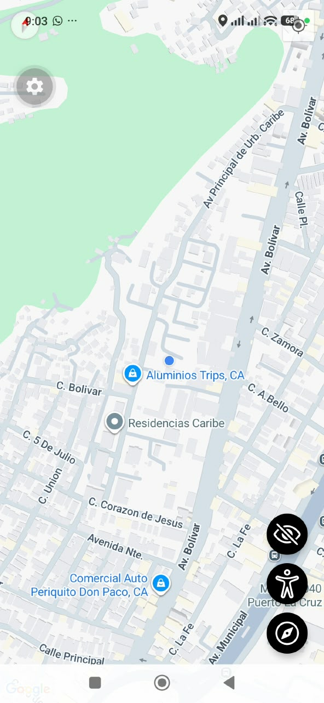

# Maps App

Aplicación de [Expo](https://expo.dev) / React Native organizada con Expo Router (SDK 58). La app consulta el **permiso de ubicación en primer plano**, muestra la pantalla de permisos cuando hace falta y, una vez concedido, obtiene la posición del dispositivo y la centra en un mapa interactivo.

Mientras la app está activa, un proveedor global escucha los cambios de ubicación, conserva un historial limitado de coordenadas y permite dibujarlo como una **polilínea** sobre el mapa. El mapa también puede seguir al usuario, dejar de seguirlo al tocar la pantalla y volver a centrarse en la posición actual.

Se usa la [documentación oficial de MapView de Expo](https://docs.expo.dev/versions/latest/sdk/map-view/) y los ejemplos de [react-native-maps en GitHub](https://github.com/react-native-maps/react-native-maps) como referencia para marcadores, polilíneas, círculos y ventanas de información.

## Pantallas

| Permisos | Mapa con seguimiento |
|:---:|:---:|
|  |  |

La primera imagen muestra `src/app/permissions/index.tsx` con el estado del permiso y el botón **Habilitar ubicación**. La segunda corresponde a `src/app/map/index.tsx`: el mapa centrado en la ubicación actual, el punto azul del usuario y los botones para alternar la ruta, seguir al usuario y recentrar la cámara.

## Qué hace la aplicación

1. `PermissionCheckProvider`, montado en `src/app/_layout.tsx`, consulta el permiso al iniciar la app.
2. Las acciones de `src/core/actions/permissions/locations.ts` traducen la respuesta de `expo-location` a un `PermissionStatus` desacoplado de la librería nativa.
3. Si el permiso es `GRANTED`, el provider navega a `/map`. En cualquier otro estado, muestra `/permissions` (después de `CHECKING`).
4. `LocationWatchProvider` inicia el seguimiento solo cuando el permiso está concedido y lo detiene cuando cambia o se desmonta.
5. `MapScreen` pide la primera ubicación; mientras llega muestra un `ActivityIndicator` y, si falla, muestra el error junto a un botón **Reintentar**.
6. `CustomMap` renderiza el `MapView` con `PROVIDER_GOOGLE`, `showsUserLocation`, controles flotantes y la `Polyline` opcional.
7. Al volver la app a primer plano, `AppState` vuelve a verificar el permiso para detectar cambios hechos desde los ajustes del sistema.

## Permisos

`PermissionStatus` (`src/infrastructure/interface/location.ts`) define los estados `CHECKING`, `GRANTED`, `DENIED`, `BLOCKED`, `LIMITED`, `UNAVAILABLE` y `UNDETERMINED`. Las acciones del núcleo son adaptadores: convierten `getForegroundPermissionsAsync` y `requestForegroundPermissionsAsync` en esos estados comunes. Una precisión reducida o aproximada se reporta como `LIMITED`; un permiso denegado que ya no se puede volver a pedir se reporta como `BLOCKED`.

La pantalla de permisos solo consume `usePermissionsStore` y delega los mensajes en el hook `useLocationPermissionAlert`. Este hook muestra una alerta distinta para cada estado y ofrece **Abrir ajustes** mediante `Linking.openSettings()` cuando el permiso fue denegado o bloqueado; en web usa `window.alert`.

## Mapa, seguimiento y polilíneas

- `CustomMap` recibe `initialLocation` desde `MapScreen` y configura la región inicial con `latitudeDelta: 0.0922` y `longitudeDelta: 0.0421`.
- Mantiene la cámara centrada en `lastKnownLocation` mientras `isFollowingUser` es `true`. El evento `onTouchStart` pone ese estado en `false` para no pelearse con el gesto del usuario.
- El botón de brújula llama a `getLocation()` y anima la cámara hacia la posición recién obtenida.
- `isRouterUser` controla si se dibuja la `Polyline` con `coordinates={userLocationList}`, `strokeColor="black"` y `strokeWidth={5}`.
- El guardián usa `Location.Accuracy.Balanced` y `distanceInterval: 40`. Para evitar copias infinitas y reenvíos costosos al componente nativo, `useLocationStore` conserva como máximo `MAX_POINTS = 600` coordenadas (≈24 km a 40 m por punto).
- La suscripción nativa de `expo-location` se guarda a nivel de módulo en `src/core/actions/locations/location.ts`, no dentro de Zustand: es un objeto no serializable y solo debe existir una activa.
- `src/app/map-simple/index.tsx` conserva un ejemplo estático con dos `Marker` sobre `PROVIDER_GOOGLE`.

## Hooks y estado con Zustand

### Hooks

- `useLocationPermissionAlert`: centraliza títulos, mensajes y acciones de las alertas de permisos; usa `useCallback`.
- `useTheme` y `useColorScheme`: resuelven la paleta clara/oscura y el valor hidratado en web.
- Los providers y pantallas usan `useEffect` para consultar permisos, reaccionar a `AppState`, navegar y solicitar la primera ubicación.
- `CustomMap` usa `useRef<MapView>` para animar la cámara y `useState` para `isFollowingUser` e `isRouterUser`.

### Stores de Zustand

`usePermissionsStore` (`src/presentation/store/usePermissionsStore.ts`):

- `locationsStatus`: estado actual del permiso (empieza en `CHECKING`).
- `setLocationPermission()`: solicita el permiso y actualiza el estado.
- `checkLocationPermissionStatus()`: vuelve a consultarlo y actualiza el estado.

`useLocationStore` (`src/presentation/store/useLocationStore.ts`):

- `lastKnownLocation`: última coordenada conocida (`ILatLng | null`).
- `userLocationList`: historial acotado de coordenadas para la polilínea.
- `isWatching`: bandera para la UI; el recurso nativo vive fuera del store.
- `locationError`: mensaje de error para mostrar el botón de reintento.
- `getLocation()`, `watchLocation()` y `clearWatchLocation()`: acciones del store.

Los componentes leen cada campo con selectores individuales; así, una actualización del GPS no fuerza un re-render del `MapView` por campos del store que no se usan.

## Estructura principal

```text
src/
├── app/
│   ├── _layout.tsx                     # Providers, tema y Stack de Expo Router
│   ├── map/index.tsx                   # Pantalla del mapa con carga/reintento
│   ├── map-simple/index.tsx            # Ejemplo estático con marcadores
│   ├── permissions/index.tsx           # Pantalla para solicitar el permiso
│   └── loading/index.tsx               # Pantalla de carga
├── core/actions/
│   ├── locations/location.ts           # get/watch/clear de expo-location
│   └── permissions/locations.ts        # Adaptador de PermissionStatus
├── infrastructure/
│   ├── index.ts
│   └── interface/
│       ├── lat-lng.ts                  # ILatLng
│       └── location.ts                 # Enum PermissionStatus
└── presentation/
    ├── components/
    │   ├── maps/Custom-Map.tsx          # MapView, Polyline y FABs
    │   └── shared/                     # FAB, ThemedText, ThemedView, ThemedPressable
    ├── hooks/
    │   ├── useLocationPermissionAlert.ts
    │   ├── use-theme.ts
    │   └── use-color-scheme.ts
    ├── providers/
    │   ├── PermissionCheckProvider.tsx  # Permiso + navegación
    │   └── LocationWatchProvider.tsx    # Ciclo de vida del watch
    └── store/
        ├── usePermissionsStore.ts
        └── useLocationStore.ts
```

## Ejecutar el proyecto

El repositorio usa Bun:

```bash
bun install
bunx expo start
```

Verificaciones antes de entregar cambios:

```bash
bunx expo lint
bunx tsc --noEmit
```
